# Introducción GitHub Actions

GitHub Actions es la herramienta de automatización integrada en GitHub. Con ella definimos **workflows** (flujos de trabajo): procesos automáticos que se ejecutan cuando ocurre algo en nuestro repositorio. Por ejemplo, cuando se abre un *pull request*, cuando se fusiona código en la rama `main` o cuando se crea una etiqueta, entre otras muchas posibilidades. En cada uno de esos casos podemos lanzar un proceso que haga por nosotros la tarea que nos interese.

Además, no estamos limitados al propio GitHub. Podríamos crear un workflow que, cada vez que se haga un *push* a la rama `main`, genere una nueva etiqueta y actualice el código en nuestro propio servidor, donde se está ejecutando la aplicación. Es una herramienta muy potente que GitHub pone a nuestra disposición.

En este apartado veremos cómo crear nuestros propios workflows. Para entenderlo, podemos compararlo con una receta de cocina. El workflow sería la receta completa para preparar un plato (por ejemplo, pasta carbonara), y cada una de las instrucciones que hay que seguir para elaborarla serían los **pasos** (*steps*). Muchos de esos pasos usan **acciones** (*actions*), que son piezas ya preparadas y reutilizables, como usar una salsa que ya viene hecha en lugar de prepararla desde cero. Nuestro objetivo es entender qué hace cada uno de esos pasos.

Hoy en día, gracias a la IA, es bastante fácil generar un workflow. Pero lo importante no es que un agente de IA sea capaz de crearlo, sino que nosotros seamos capaces de leerlo y entenderlo. Lo mismo ocurre con los workflows que encontremos en Internet o con los que el propio GitHub nos sugiere según el tipo de repositorio. En todos los casos tenemos que **saber leerlos, entenderlos y adaptarlos a nuestras necesidades**.

### Objetivos de aprendizaje {.unnumbered}

**En esta sección vamos a aprender sobre** GitHub Actions y la automatización de tareas mediante workflows, desde la creación del primer flujo hasta su depuración.

Temas puntuales:

- Creación de workflows: estructura, eventos, jobs y steps

- Variables de usuario y de entorno, y recepción de data externa (inputs)

- Actions comunes como checkout e instalaciones dentro del runner

- CRON Jobs y ejecución de scripts personalizados

- Depuración de scripts y workflows

## Preparación del repositorio

Para trabajar en este apartado necesitamos tener el siguiente repositorio en nuestra cuenta de GitHub:

<https://github.com/KlerithX2/legion-del-mal>

No hace falta conservar todo el historial de commits. Lo que sí necesitamos es la misma estructura de archivos y directorios, porque a lo largo del apartado vamos a modificar código, consultar *issues* y, en definitiva, trabajar con distintas partes del repositorio. Hay dos formas de conseguirlo:

- **Descargar el código fuente** en formato `.zip` y subirlo después como un repositorio nuevo en nuestra cuenta.
- **Hacer un *fork*** del repositorio original. Si elegimos esta opción, hay que tener en cuenta dos cosas:
  - Los *issues* vienen desactivados por defecto en los *forks*. Hay que activarlos en *Settings → General → Features → Issues*, porque más adelante vamos a trabajar con ellos.
  - Los workflows también vienen desactivados por defecto. La primera vez que entremos en la pestaña *Actions*, GitHub nos pedirá confirmar que queremos habilitarlos.

Con el repositorio listo, vamos a la pestaña **Actions** del repositorio.

GitHub Actions es la plataforma de GitHub para la **integración continua y el despliegue continuo** (CI/CD, *Continuous Integration / Continuous Deployment*). Nos permite ejecutar tareas automáticas cuando ocurre un evento en el repositorio. Por ejemplo:

- se sube un cambio al código,
- se crea o se modifica un *issue*,
- se abre un *pull request*,
- o se llega a una hora programada (por ejemplo, todos los lunes a las 8:00).

Estas tareas se definen en **workflows** y se ejecutan en máquinas llamadas **runners**. Normalmente usamos los runners que proporciona GitHub, que son máquinas virtuales que se crean para cada ejecución. También podemos configurar runners propios (*self-hosted*) en nuestros servidores.

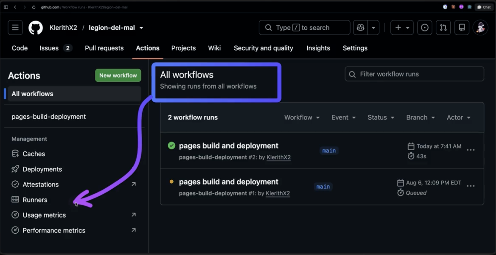

A partir de ahora vamos a crear *workflows* que realizan tareas sobre nuestro repositorio: modificar su contenido, enviar una notificación o, en general, cualquier cosa que nos interese automatizar. Las posibilidades son prácticamente ilimitadas.

Para terminar de preparar el entorno, necesitamos **tener los ficheros del repositorio en local**, porque a partir de ahora editaremos los workflows desde VS Code. Basta con clonar el repositorio que hemos creado en nuestra cuenta de GitHub, ya sea un *fork* o uno nuevo subido desde el `.zip`:

``` bash
git clone https://github.com/<tu-usuario>/legion-del-mal.git
```

## Mi primer workflow

Para crear nuestro primer workflow, nos dirigimos a la pestaña actions y pulsaremos sobre el botón *New workflow*.

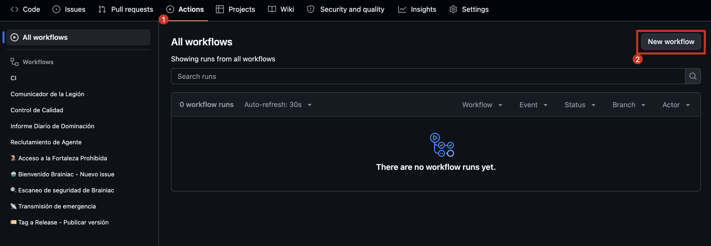

En esta nueva pantalla, habitualmente GitHub nos proporcionará una sección denominada "Suggested for this repository", donde encontraremos un elemento denominado "**Simple workflow**":

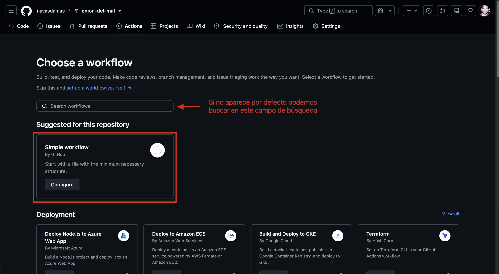

Como se indica en la captura, en el caso de que GitHub no nos sugiera este workflow, siempre podríamos utilizar el cuadro de búsqueda para buscar este mismo elemento por nuestra cuenta. Una vez localizado seleccionamos la opción "**Configure**" del mismo.

A continuación se nos muestra una nueva pantalla donde podemos ver y editar el código que compone este workflow. Vamos a proceder ahora a analizar lo que se nos muestra aquí:

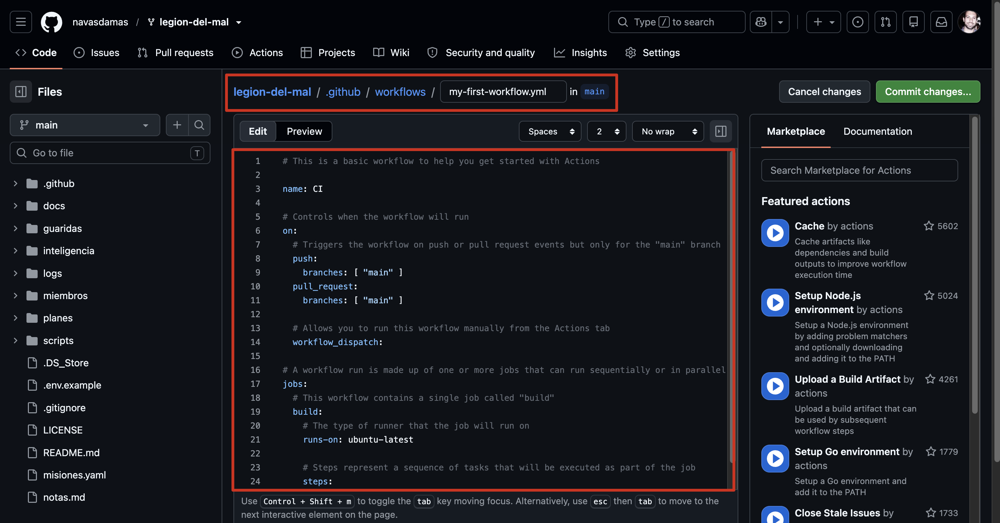

Como se puede observar, al crear un nuevo workflow se genera un archivo tipo `.yml` que podemos renombrar como mejor nos parezca (el nombre debe ser algo descriptivo sobre la tarea que va a hacer, pero no está técnicamente asociado a ninguna otra parte del proyecto). Este archivo se alojará en la carpeta `workflows`, que a su vez se encuentra dentro del directorio oculto `.github` de la raíz de nuestro repositorio.

Debajo de la ruta donde se alojará el fichero, tendremos acceso al editor de código del mismo. Aquí tendremos la posibilidad de activar el modo *edit* (para modificar el archivo directamente) y el modo *preview* (solo lectura). Vamos a analizar lo que nos contiene este archivo:

``` {.yml include="../../ejemplos/03-produccion/t03-github-actions/ej01-my-first-workflow.yml"}
```

A continuación vamos a ir desgranando cada una de sus partes:

``` yml
name: CI
```

Esta línea nos indica el **nombre** que tiene el workflow, en este caso "CI" que viene de "Continous Integration". Básicamente es un título descriptivo del trabajo que el workflow va a realizar y es totalmente personalizable.

``` yml
# Controls when the workflow will run
on:
  # Triggers the workflow on push or pull request events but only for the "main" branch
  push:
    branches: [ "main" ]
  pull_request:
    branches: [ "main" ]

  # Allows you to run this workflow manually from the Actions tab
  workflow_dispatch:
```

La instrucción `on` nos indica básicamente **qué evento (o eventos) debe suceder para que se ejecute este workflow** de forma automática. En este ejemplo en concreto nos está indicando que se activará cuando se haga un *push* o un *pull request* a la rama *main* (en este caso solo hay una, pero si nos fijamos, el nombre de la rama está dentro de un array por lo cual podríamos añadir más de una).

Habitualmente, en esta parte de los workflows, también podemos encontrar la instrucción `workflow_dispatch:` (como en este caso). Esta instrucción es la que nos permite poder lanzar el workflow directamente desde la propia interfaz de GitHub Actions. Si esta instrucción no aparece significa que el workflow solo se activará cuando se den algunos de los eventos establecidos en la sección `on`.

``` yml
# A workflow run is made up of one or more jobs that can run sequentially or in parallel
jobs:
  # This workflow contains a single job called "build"
  build:
    # The type of runner that the job will run on
    runs-on: ubuntu-latest

    # Steps represent a sequence of tasks that will be executed as part of the job
    steps:
      # Checks-out your repository under $GITHUB_WORKSPACE, so your job can access it
      - uses: actions/checkout@v4

      # Runs a single command using the runners shell
      - name: Run a one-line script
        run: echo Hello, world!

      # Runs a set of commands using the runners shell
      - name: Run a multi-line script
        run: |
          echo Add other actions to build,
          echo test, and deploy your project.
```

Por último, tenemos la sección de la instrucción `jobs`. Básicamente un workflow se compone de uno o más de estos trabajos que se pueden ejecutar secuencialmente o en paralelo. En este caso nuestro workflow solo tiene un único trabajo denominado "build", aunque en realidad este nombre no es una instrucción, es decir es totalmente personalizable y podríamos llamarlo como nos interese ("construcción", "reporte", ...).

Ahora bien, usualmente a continuación del nombre del trabajo vamos a ver una instrucción tipo `runs-on` que nos indica qué servidor va a ejecutar este trabajo (alguno de los "runners" que hemos mencionado previamente). Por ejemplo, en este caso podemos ver que se va a ejecutar en un servidor que aloja una máquina virtual con la última versión del sistema operativo *Ubuntu* y una serie de preinstalaciones. Algunas de las máquinas virtuales que podríamos invocar aquí son: ubuntu-latest, ubuntu-22.04, ubuntu-20.04, windows-latest, windows-2022, windows-2019, `macos-latest`, `macos-13` o `macos-12`.

A continuación ya sí vamos a ver la parte de lo que denominamos "acciones". Dentro de la instrucción `steps` se definen una serie de pasos: - En primer lugar se llama a la acción denominada `actions/checkout@v4` que basicamente lo que hace es habilitarnos el acceso a nuestro repositorio cargandolo en la máquina Ubuntu que hemos configurado, para que esté disponible (no os preocupéis de momento por esto porque lo vamos a practicar más adelante). El `@v4` nos indica la versión de la acción. - A continuación escribe las instrucciones para ejecutar un script de una única línea. `name` nos indica el nombre que tendrá el script, mientras que `run` contine la instrucción que se ejecutará, en este caso un simple `echo Hello, world!`. - Por último, tenemos las instrucciones que nos permiten ejecutar un script de múltiples líneas. Del mismo modo que antes, en el `name` se establece el nombre del script mientras que en `run` se escribe el carácter de tubería `|` seguido de las instrucciones que deseemos ejecutar. En este ejemplo se puede observar que simplemente se ejecutarían dos `echo`.

Dejando a un lado el panel de edición y revisión del código, nos fijamo ahora en el panel de la derecha:

::: {#fig-menu-lat-derecho layout-ncol="2"}
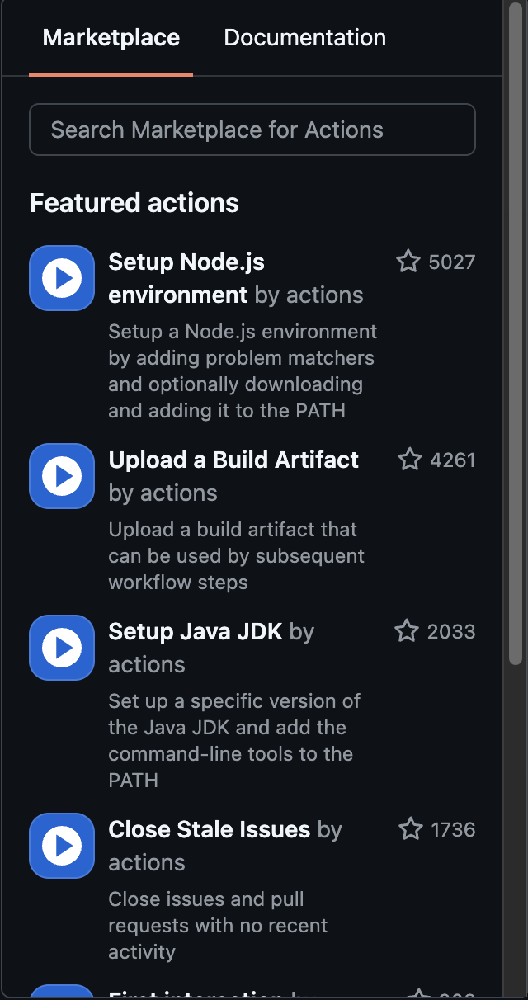{#fig-marketplace}

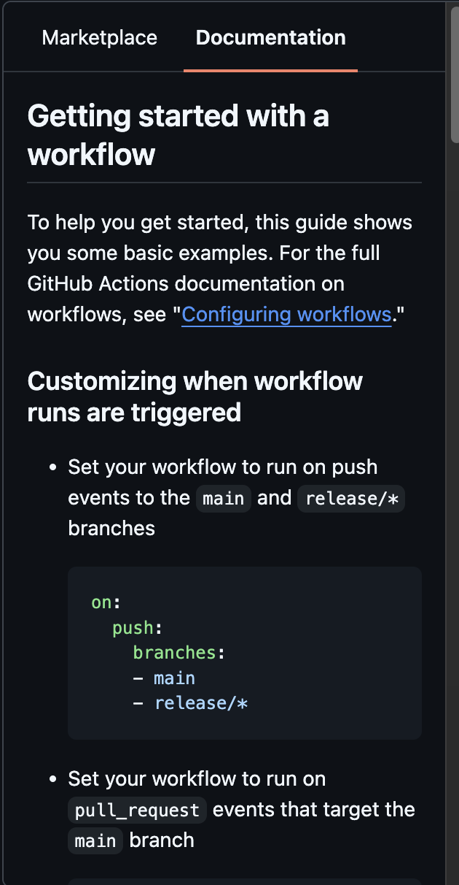{#fig-documentacion}

Menú lateral derecho
:::

En la figura @fig-marketplace encontramos una **"tienda" de acciones** que podríamos añadir a nuestro workflow. Desde aquí podríamos buscar acciones concretas que nos interesen para nuestro caso concreto, por ejemplo en la figura @fig-accion-ejemplo se muestra una acción del marketplace para configurar un entorno de Node.js en nuestro *runner*. Para usarlo simplemente podríamos copiar el código de la sección "Installation" y pegarlo en nuestro fichero `.yml`.

> Tener en cuenta que si revisamos este código, hay mucho texto dentro de la sección `with`. Esto es porque esta sección de la configuración de la acción es totalmente opcional y nos permite, si fuese necesario, añadir argumentos que nosotros le podemos mandar a una acción (lo veremos más adelante).

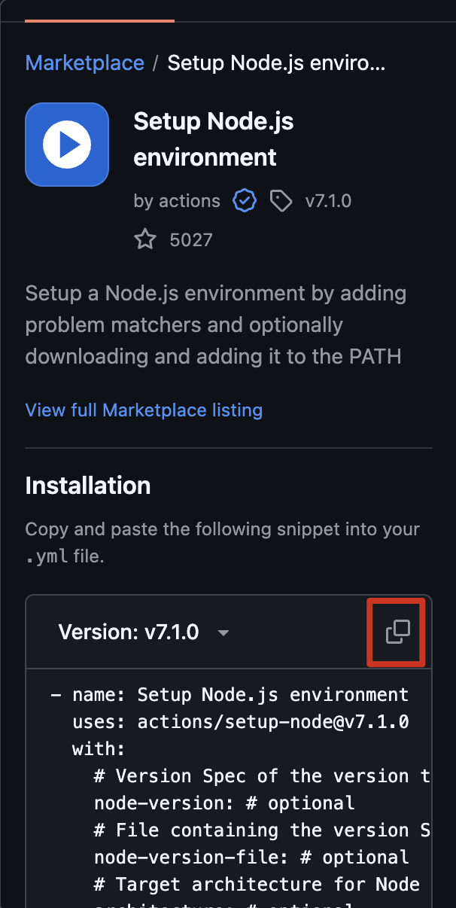{#fig-accion-ejemplo width="40%"}

Por otro lado, en la figura @fig-documentacion se muestra la **documentación** que nos proporciona el propio GitHub del workflow y las acciones que contiene.

A continuación, vamos a realizar el *commit* de los cambios que hemos realizado (la creación del archivo `.yml`), de la forma en que se muestra en @fig-commit-first-workflow (podemos establecer un mensaje personalizado si lo deseamos).

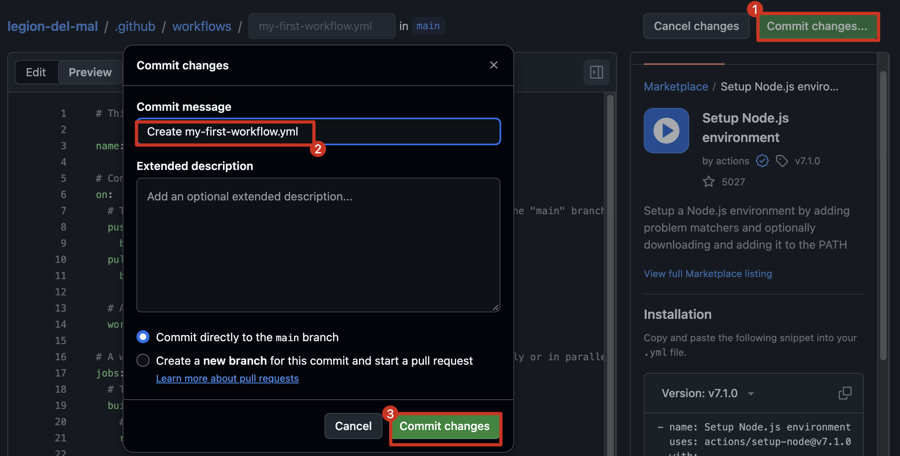{#fig-commit-first-workflow}

Por si no habéis caido, al hacer esto ya directamente vamos a provocar que se lance el workflow, ya que estamos añadiendo un *commit* (que en realidad es lo mismo que hacer un *push*) al *main*. De hecho si nada mas crear el *commit* nos dirigimos al panel de *actions* en nuestro repositorio de GitHub podremos ver que la acción se está ejecutando, algo similar a lo que se muestra en la siguiente figura.

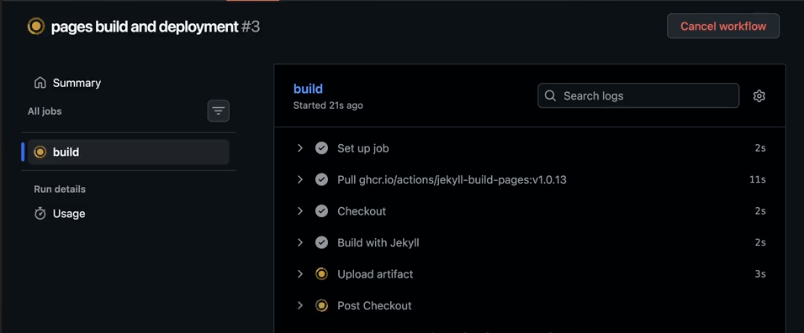{#fig-workflow-exec}

Cuando se termine de ejecutar el workflow se quedará el registro dentro de la pestaña de *actions* y podremos revisarlo y comprobar qué sucedió durante su ejecución.

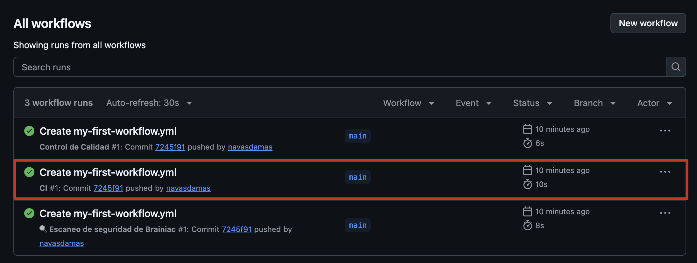{#fig-review-workflow-1}

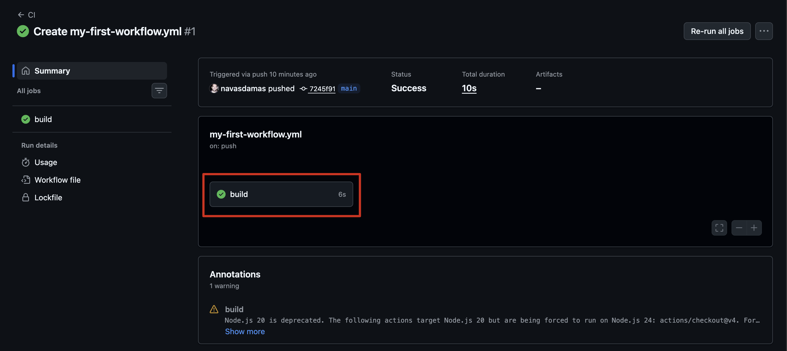{#fig-review-workflow-2}

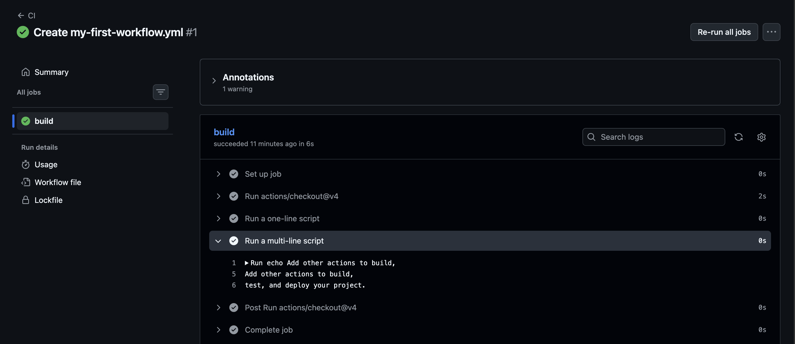{#fig-review-workflow-3}

Como se puede ver en las figuras anteriores, en el listado que encontramos en la pestaña *actions* hemos localizado una ejecución del workflow "CI" que hemos creado, que nos indica además que se ha lanzado a raíz de que se ha *pusheado* un nuevo commit en la rama *main* y además nos indica en qué instante de tiempo se llevó a cabo este evento.

Si hacemos clic sobre este elemento del listado podemos revisar el detalle de la ejecución de este workflow (ver @fig-review-workflow-2), que entre otras cosas nos ofrece el estado ("Success" o exitoso), la duración de su ejecución (10 segundos), el usuario que generó el evento que dió lugar a su ejecución, entre otros detalles. También podemos ver todos los *jobs* que se han ejecutado durante este workflow, en este caso sólo el denominado "build". Si hacemos clic sobre él entraríamos en su vista de detalle (ver @fig-review-workflow-3) donde se nos detallan los mensajes de salida de las ejecuciones de las diferentes acciones que se han producido durante este *job*. Por ejemplo, si revisamos el detalle de la ejecución del script que denominamos "Run a multi-line script" podemos ver las instrucciones que contenía el script y la salida correspondiente (en este caso los mensajes del *echo*).

> Es importante señalar que si alguno de los pasos del workflow fallase por algún motivo, no continuaría haciendo nada de lo demás. Si esto ocurriera, normalmente GitHub nos notificaría mediante un correo electrónico indicando los detalles del error.

Como hemos mencionado antes, en este workflow tenemos una instrucción que nos permite activarlo de forma manual. Para hacer esto, nos dirigimos a la pestaña *actions* del repositorio de GitHub y podremos comprobar que en el panel lateral izquierdo nos aparecerá un listado donde aparece un elemento denominado "CI", que es el nombre que le hemos asignado a nuestro nuevo workflow:

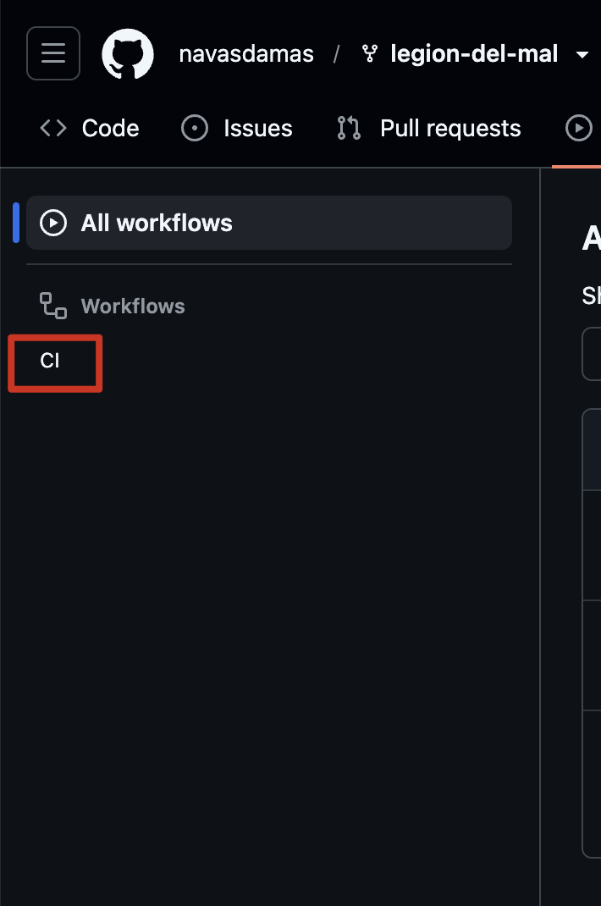{#fig-listado-workflows width="40%"}

Si pulsamos sobre él nos aparecerá un listado de las ejecuciones que ha tenido dicho workflow (igual que aparecía en @fig-review-workflow-1) y en la esquina superior derecha podremos localizar un botón denominado "Run workflow". Si lo pulsamos nos aparecerá un cuadro de dialogo donde se nos pide la rama sobre la que ejecutar el workflow, que habitualmente va a ser "main", por lo que simplemente confirmamos en el botón con el mismo nombre y esto hará que el workflow se ejecute de igual manera que ocurrió cuando se activó de forma automática cuando añadimos un *push* al "main".

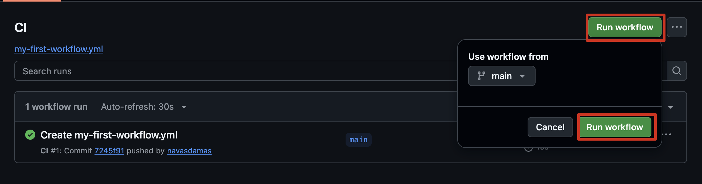{#fig-run-workflow}

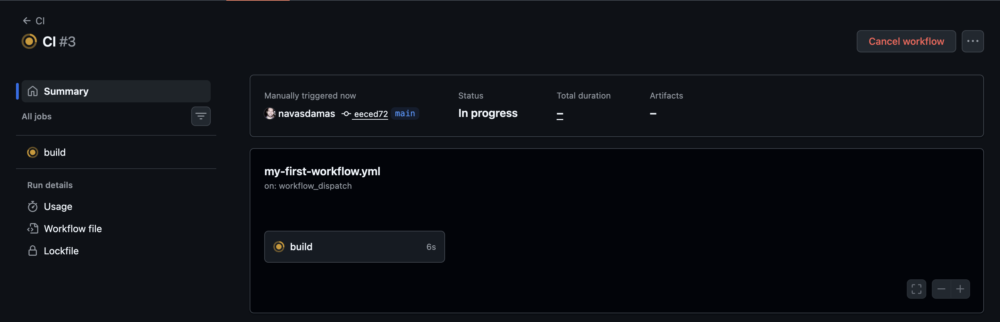{#fig-running-workflow}

Cuando un workflow está en ejecución, si revisamos su detalle podremos ver algo similar a lo que se muestra en @fig-running-workflow. Una vez finalizado, podríamos dirigirnos a la pestaña *actions* nuevamente y si nos fijamos podemos diferenciar cuando el workflow se ejecutó de forma automática y de forma manual, como se puede observar en la siguiente figura.

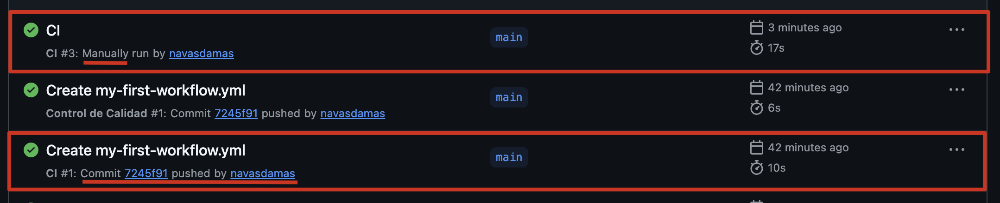{#fig-workflow-manual-vs-auto}

> Desde la vista del detalle de la ejecución de un workflow (por ejemplo lo que se muestra en @fig-running-workflow) podemos acceder al archivo donde se encuentra definido dicho workflow, si pulsamos en el botón "**Workflow file**" del menú lateral izquierdo (bajo la sección "Run details").

Para finalizar, como hemos añadido un nuevo archivo en nuestro repositorio remoto alojado en GitHub, deberíamos traer estos cambios a nuestra copia local del repositorio. Para ello como sabéis hay que ejecutar un _pull_ del main desde el terminal en nuestro equipo local, y si todo va bien ya tendriamos en nuestro equipo el fichero `my-first-workflow.yml` que hemos creado desde GitHub y podríamos trabajar con él, revisarlo y modificarlo directamente en local. Es posible que al abrir por primera vez un archivo de este estilo el editor de código VS Code os pregunte si deseáis instalar la extensión para trabajar con workflows, podéis hacerlo y esto nos proporcionará revisión del código automática en tiempo real de estos archivos.

## Variables de usuario y entorno